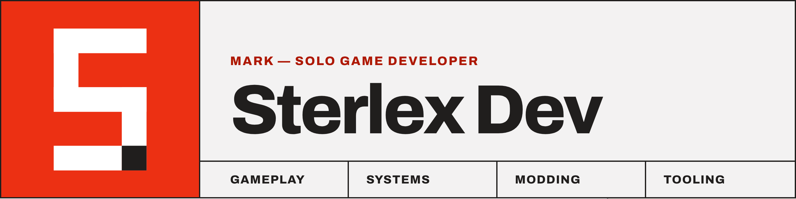

  

I'm Mark — a solo game developer building gameplay and systems in **Unity** with **C#** and **C++**. I also make game mods, custom tools and utilities, and write **TypeScript** for developer tooling and automation.

<table>
  <tr>
    <td width="40%" valign="top">
      <b>GAME DEV</b> 
      <h3>Gameplay &amp; Systems</h3>
      Solo, start to ship
    </td>
    <td width="40%" valign="top">
      <b>MODDING</b> 
      <h3>Mods &amp; Tools</h3>
      Custom tools and utilities
    </td>
    <td width="50%" valign="top">
      <b>ENGINE</b> 
      <h3>Unity · C# · C++</h3>
      Core code and performance
    </td>
    <td width="50%" valign="top">
      <b>TOOLING</b> 
      <h3>TypeScript</h3>
      Just in love
    </td>
  </tr>
</table>

### Stack

---

<b>github.com/sterlex</b> · Open to collabs on games, mods and tools
