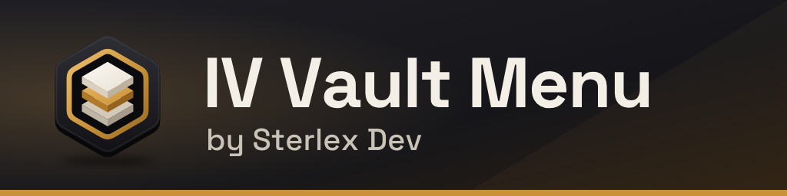

<table>
<tr>
<td width="22%" align="center"></td>
<td width="78%" valign="middle">
INDEPENDENT GAME DEVELOPMENT & SOFTWARE
<h1>Sterlex Dev</h1>
Gameplay programming · Engine development · Game modding
  
EST. 2007 &nbsp; / &nbsp; <a href="https://github.com/sterlex">GITHUB</a> &nbsp; / &nbsp; <a href="https://www.nexusmods.com/gta4/mods/1806">NEXUS MODS</a>
</td>
</tr>
</table>

I'm Mark, a solo game developer who started out modding games in 2007. Today I work with **Unity, C# and C++**, building gameplay systems, exploring engine architecture and working towards my own game physics engine. I also develop GTA mods, custom utilities and TypeScript applications.

 

01 — SELECTED WORK

## Projects

<table>
<tr><td width="12%" align="center"></td><td width="62%"><b>IV Vault Menu</b> GTA IV: The Complete Edition</td><td width="26%" align="right"></td></tr>
<tr><td colspan="3">A runtime trainer focused on stable native game integration, live vehicle previews, gameplay customization and world manipulation.  <code>C#</code> <code>ScriptHookDotNet CE</code> <code>NativeUI IV</code>  <a href="https://www.nexusmods.com/gta4/mods/1806">Nexus Mods</a> &nbsp; / &nbsp; <a href="https://libertycity.net/file/248025">LibertyCity</a></td></tr>
</table>

<table>
<tr><td width="74%"><b>SterlexEngine</b> REAL-TIME 3D ENGINE & EDITOR</td><td width="26%" align="right"></td></tr>
<tr><td colspan="2">A handcrafted C++20 engine project exploring real-time rendering, scene hierarchy, transform gizmos, editor architecture and physics simulation.  <code>C++20</code> <code>OpenGL 4.5</code> <code>Dear ImGui</code> <code>CMake</code></td></tr>
</table>

 

02 — ENGINEERING DISCIPLINES

## Technical focus

<table>
<tr><td width="50%" valign="top">01 / GAMEPLAY<h3>Gameplay & Systems</h3>Player controllers, camera systems, reusable components, enemy AI and gameplay mechanics.  <code>Unity</code> <code>C#</code></td><td width="50%" valign="top">02 / ENGINE<h3>Engine & Physics</h3>Rendering, scene architecture, transform systems and research into collision detection and rigid-body simulation.  <code>C++20</code> <code>OpenGL</code></td></tr>
<tr><td valign="top">03 / MODDING<h3>Runtime Integration</h3>Native game functions, trainers, in-game UI, configuration, compatibility and debugging.  <code>ScriptHook</code> <code>NativeUI</code></td><td valign="top">04 / TOOLING<h3>Developer Tools</h3>Desktop utilities, application interfaces, build automation and packaging.  <code>TypeScript</code> <code>Tauri</code> <code>Node.js</code></td></tr>
</table>

 

03 — DEVELOPMENT ENVIRONMENT

## Stack

| Discipline | Technologies |
| :--- | :--- |
| Programming |    |
| Game & graphics |    |
| Applications |   |
| Build & workflow |    |

---

 <b>Sterlex Dev</b> Open to collaborations on games, engines, mods and tools.

